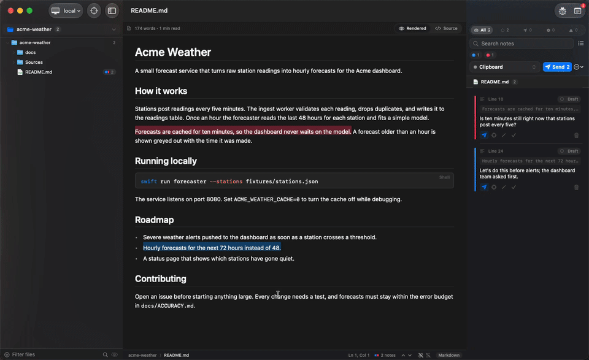

<p align="center">
  
</p>

<h1 align="center">Gloss</h1>

<p align="center">
  <b>Mark up any file. Hand the notes to your agent.</b><br>
  <a href="https://github.com/colinc86/gloss/releases/latest"></a>
  
</p>

<p align="center">
  <picture>
    <source media="(prefers-reduced-motion: reduce)" srcset="docs/media/hero.png">
    
  </picture>
</p>

Gloss is a native Mac app that sits beside your terminal. Open any file, on this Mac or over ssh, highlight what
needs to change, and write a note. Gloss sends your notes to Claude Code, Codex or OpenCode as precise, anchored
context, and the agent marks each one resolved when it's done.

- **Notes on anything.** Any stretch of code or text, Markdown rendered or source, a region of an image, a region
  or passage of a PDF, CSV cells, rows or columns, a web page's text or elements, a whole file, or a picture inside
  a Markdown file, Jira issue or Confluence page (part of it or all of it).
- **Local and remote.** Browse and edit files on this Mac or on any host in your ssh config (or one you add in
  Settings), even when your terminal reaches it over mosh or inside tmux.
- **Find your way.** Open Quickly, Find in Files, Go to Line, favorite folders, and Back and Forward between the
  places you've been.
- **Every way to reach an agent.** Herdr, OpenCode's API, tmux or the clipboard out; MCP for the agent's replies.
  Nothing leaves Gloss until you press Send.
- **Reviews too.** GitHub pull requests, Jira issues and Confluence pages open as documents you can annotate.
- **Work through notes together.** Select several cards to send, resolve, recolor, copy as a packet or delete them
  at once, or put sent and resolved notes back to drafts. Edit a note right in its card.
- **Link and paths.** The notes panel follows the page, and a curve runs from each highlight to the middle of its
  card's color bar.
- **Picks up where you left off.** Your folders, the document you were reading and where, Back and Forward, and the
  notes panel come back when Gloss opens, as your Mac's "Close windows when quitting" setting says.
- **Your files stay yours.** Notes live in Gloss, never in the file.
- **Your icon, your way.** Settings › General › App Icon picks one of 16 styles for the Dock while Gloss is open.

## Install

Gloss needs macOS 26 or later.

1. Download the [latest release](https://github.com/colinc86/gloss/releases/latest).
2. Open **Settings › Agents** and press **Install** beside the agents you use. See [Connecting agents](docs/guide/agents.md).

## How it works

You and the agent take turns on the same files. Gloss is where your half happens.


1. **Your agent changes some files.** Gloss shows the changes as they happen, on your Mac or on a server, and your
   notes move along with the text they're about.
2. **You read it over and leave notes.** Select something, press **Add Note**, and say what you'd like changed.
   Nothing goes anywhere until you press Send, so take your time. Notes you haven't sent yet are filled in on the
   page; sent ones fade to an underline, so you can see at a glance what's still to do. Changed your mind? **Back
   to Draft** takes a note back.
3. **Your agent gets to work.** It receives all your notes at once, each with the file, the exact spot, the text
   you highlighted and what you said about it. As it finishes each one it checks it off in Gloss, and if it gets
   stuck it asks you, right beside the text, under the agent's name. Answer with **Reply** and send it back.

<details>
<summary>What the agent receives</summary>

```text
File: /home/me/acme-weather/docs/PLAN.md
Source: markdown

Line 8
Excerpt:
> We should cache the forecast results for ten minutes at most, and less for severe-weather alerts.
User comment: "Alerts can't wait ten minutes. Give them their own TTL, at most one minute."

Line 20
Image: dashboard.png (1440x880)
Region: x=1004 y=96 w=400 h=220 (crop attached)
Attachment: /home/me/.cache/gloss/attachments/s_01J9XQ9C4H6M8P0R2T4V6X8Z0B/1-dashboard-region-A3K7QM.png
User comment: "The legend overlaps the chart here. Move it below."

Notes: 2. Mark each resolved with the gloss MCP tool `resolve_note` (ids: n_01J9XQ4M2T8V6K3R5W7Y9ZB1CD, n_01J9XQ7B8R2N4P6S8T0VA3K7QM) when done.
```

</details>

## FAQ

**Does Gloss change my files?**
Only when you change one yourself: edit and save a code, text or Markdown file, or create, rename, duplicate or
delete files in the explorer. Notes are stored in Gloss's own database, keyed by host and path, so nothing is
written into the files you annotate.

**Which agents does it work with? Do I need Herdr?**
Claude Code, Codex and OpenCode are set up from Settings › Agents, and any agent that speaks MCP can read and resolve
the notes you send it. Herdr is optional; tmux and the clipboard work with anything.

**Can an agent see notes I haven't sent?**
No. Drafts stay in Gloss until you press Send; agents only ever see notes you've sent them.

**Can I take a note back after sending it?**
Yes. **Back to Draft** on the card (or on several selected cards) makes it a draft again to change and resend. The
agent may already have read it, but it can't resolve it until you send it again.

**Does it work on remote machines?**
Yes. Gloss uses your system `ssh` and your ssh config with its own connection, so it doesn't care how your terminal
reaches the host. No daemon or binary is installed there. When you install an agent for a host in Settings › Agents,
Gloss adds itself to that agent's config on the host, and pictures you send are copied to
`~/.cache/gloss/attachments` there so the agent can open them.

**Will it post to GitHub, Jira or Confluence?**
No. Gloss only reads with your keys. Your agent makes changes with its own tools; the packet names the exact pull
request, issue or page. The one exception is the ladybug in the toolbar, which files feedback on Gloss's own repo.

**Where are my notes and keys kept?**
Notes are in `~/Library/Application Support/Gloss/gloss.sqlite`. API keys are in your Keychain.

**What happens to a note when the agent rewrites that code?**
Gloss finds the text again nearby and moves the note. If it can't, the note is marked orphaned so you can look
before sending it again. When the match is less certain, the note moves and is flagged for a glance.

**Does Gloss collect anything about me?**
No. It talks only to what you connect it to, plus GitHub to check for updates. Rendered Markdown also fetches the
pictures a document links to on the web (badges, screenshots), as GitHub does.

**Can the agent show me things in Gloss?**
Yes. Over MCP it can open a file at the lines it means (or a pull request, issue or web page), ask you a question
beside them (it shows under Attention in a bubble with the agent's name; you answer with **Reply**, and the answer
goes back when you send it), and add a project folder to your favorites.

**Does Gloss reopen what I had open?**
Yes, as your Mac does: if "Close windows when quitting an application" is off in Desktop & Dock, everything comes
back; if it's on, just the last folder. **Settings › General › When Gloss opens, reopen** chooses for Gloss alone.

**How do I report a bug or ask for a feature?**
Click the ladybug in the toolbar, or choose Help › Report a Bug or Request a Feature….

## Documentation

The [user guide](docs/guide/README.md) covers everything in more depth:

- [Getting started](docs/guide/getting-started.md): install, open a folder, find files, pick up where you left off,
  view and edit, stay up to date, report a bug
- [Notes](docs/guide/notes.md): making notes in every viewer, the notes panel, a note's life, link and paths
- [Connecting agents](docs/guide/agents.md): setting agents up, the ways a note reaches them, sending, resolving,
  when an agent wants you to look, Herdr
- [Remote hosts](docs/guide/remote-hosts.md): ssh hosts, remote editing, remote dev servers, Herdr follow mode
- [Integrations](docs/guide/integrations.md): pull requests, Jira, Confluence and the review browser

Working on Gloss itself? Start with [PRODUCT.md](docs/PRODUCT.md), [DESIGN.md](docs/DESIGN.md) and
[RELEASE.md](docs/RELEASE.md).
