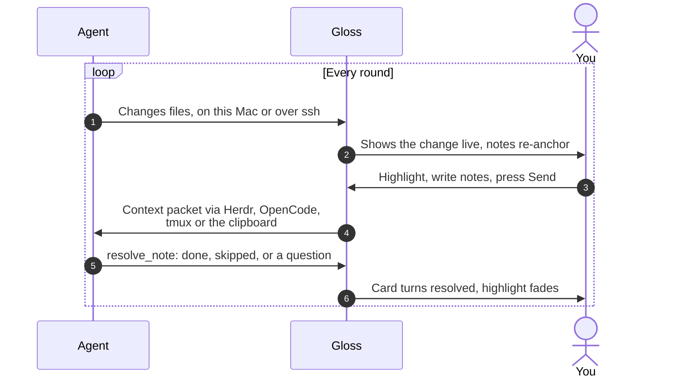

<p align="center">
  
</p>

<h1 align="center">Gloss</h1>

<p align="center">
  <b>Mark up any file. Hand the notes to your agent.</b><br>
  <a href="https://github.com/colinc86/gloss/releases/latest"></a>
  
</p>

<p align="center">
  <picture>
    <source media="(prefers-reduced-motion: reduce)" srcset="docs/media/hero.png">
    
  </picture>
</p>

Gloss is a native Mac app that sits beside your terminal. Open any file, on this Mac or over ssh, highlight what
needs to change, and write a note. Gloss sends your notes to Claude Code, Codex or OpenCode as precise, anchored
context, and the agent marks each one resolved when it's done.

- **Notes on anything.** Code and text by line, Markdown rendered or source, image and PDF regions, spreadsheet
  cells, web page elements, or a whole file.
- **Local and remote.** Browse and edit files on any host in your ssh config, even when your terminal reaches it
  over mosh or inside tmux.
- **Every way to reach an agent.** Herdr, OpenCode's API, tmux or the clipboard out; MCP for the agent's replies.
  Nothing leaves Gloss until you press Send.
- **Reviews too.** GitHub pull requests, Jira issues and Confluence pages open as documents you can annotate.
- **Link and paths.** The notes panel follows the page, and each highlight is drawn to its card.
- **Your files stay yours.** Notes live in Gloss, never in the file.

## Install

Gloss needs macOS 26 or later.

1. Download `Gloss-x.y.z.zip` from the [latest release](https://github.com/colinc86/gloss/releases/latest).
2. Unzip it, move **Gloss.app** to Applications, and open it. It's signed and notarized.
3. Open **Settings › Agents** and press **Install** beside the agents you use. See [Connecting agents](docs/guide/agents.md).

Gloss updates itself. While its repository is private, updates need a GitHub token that can read it, saved in
**Settings › Integrations**.

## How it works

You and the agent take turns on the same files. Gloss is where your half happens.



1. **The agent changes files.** Gloss reloads them as they change, locally or on a remote host, and moves your
   existing notes to follow the text.
2. **You review and annotate.** Select a range, a region or an element, press **Add Note**, and say what you want.
   Notes stay drafts until you send them, one at a time or all together.
3. **The agent answers.** It gets one packet with every note's file, location, excerpt and your comment, works
   through them, and resolves each note through Gloss's MCP server: done, skipped, or with a question for you.

<details>
<summary>What the agent receives</summary>

```text
File: /home/me/acme-weather/docs/PLAN.md
Source: markdown

Lines 40-52
Excerpt:
> ## Auth flow
> The client refreshes tokens every 5 minutes...
User comment: "This contradicts the 15 minute TTL in api.md. Pick one and fix both."

File: /home/me/acme-weather/design/dashboard.png
Source: image
Original size: 2880x1800

Region: x=1204 y=312 w=640 h=220 (crop attached)
Attachment: /home/me/.cache/gloss/attachments/a1b2c3/dashboard-region-1.png
User comment: "The legend overlaps the chart here. Move it below."

Notes: 2. Mark each resolved with the gloss MCP tool when done.
```

</details>

## FAQ

**Does Gloss change my files?**
Only when you edit a text or Markdown file yourself and save it. Notes are stored in Gloss's own database, keyed by
host and path, so nothing is written into the files you annotate.

**Which agents does it work with? Do I need Herdr?**
Claude Code, Codex and OpenCode are set up from Settings › Agents, and any agent that speaks MCP can read and resolve
the notes you send it. Herdr is optional; tmux and the clipboard work with anything.

**Can an agent see notes I haven't sent?**
No. Drafts stay in Gloss until you press Send; agents only ever see notes you've sent them.

**Does it work on remote machines?**
Yes. Gloss uses your system `ssh` and your ssh config with its own connection, so it doesn't care how your terminal
reaches the host. Nothing is installed on the remote machine.

**Will it post to GitHub, Jira or Confluence?**
No. Gloss only reads with your keys. Your agent makes changes with its own tools; the packet names the exact pull
request, issue or page. The one exception is the ladybug in the toolbar, which files feedback on Gloss's own repo.

**Where are my notes and keys kept?**
Notes are in `~/Library/Application Support/Gloss/gloss.sqlite`. API keys are in your Keychain.

**What happens to a note when the agent rewrites that code?**
Gloss finds the text again nearby and moves the note. If it can't, the note is marked orphaned so you can look
before sending it again.

**Does Gloss collect anything about me?**
No. It talks only to what you connect it to, plus GitHub to check for updates.

**Can the agent show me things in Gloss?**
Yes. Over MCP it can open a file at the lines it means, ask you a question beside them (you answer with Reply, and
the answer goes back when you send it), and add a project folder to your favorites.

**How do I report a bug or ask for a feature?**
Click the ladybug in the toolbar, or use Help › Report a Bug or Request a Feature….

## Documentation

The [user guide](docs/guide/README.md) covers everything in more depth:

- [Getting started](docs/guide/getting-started.md): install, open a folder, find files, stay up to date
- [Notes](docs/guide/notes.md): making notes in every viewer, the notes panel, link and paths
- [Connecting agents](docs/guide/agents.md): targets, transports, sending and resolving
- [Remote hosts](docs/guide/remote-hosts.md): ssh hosts, remote editing, Herdr follow mode
- [Integrations](docs/guide/integrations.md): pull requests, Jira, Confluence and the review browser

Working on Gloss itself? Start with [PRODUCT.md](docs/PRODUCT.md), [DESIGN.md](docs/DESIGN.md) and
[RELEASE.md](docs/RELEASE.md).
