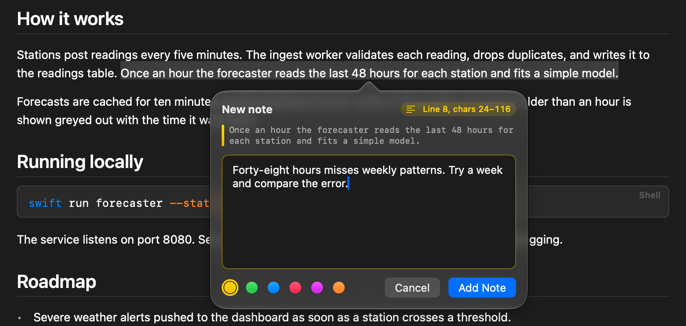
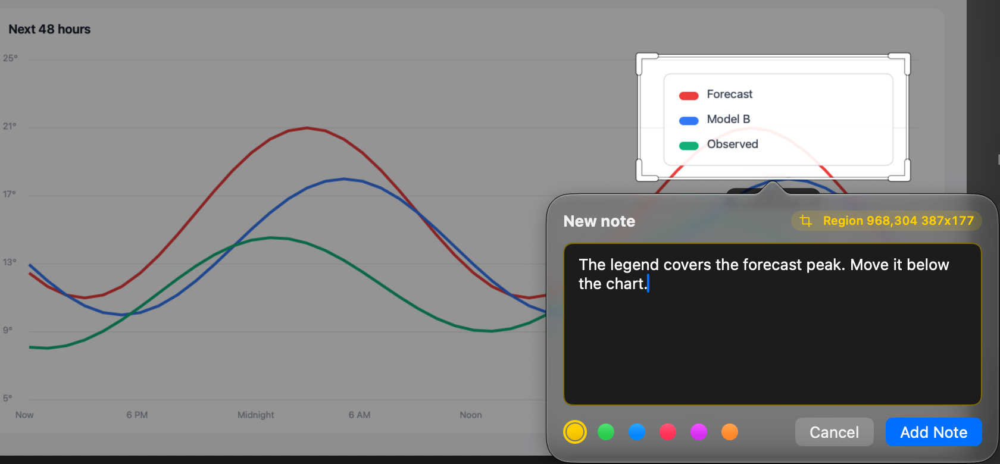

<p align="center">
  
</p>

<h1 align="center">Gloss</h1>

<p align="center">
  <b>Mark up any file and send to your agent.</b><br>
  <a href="https://github.com/colinc86/gloss/releases/latest"></a>
  
</p>

<p align="center">
  <picture>
    <source media="(prefers-reduced-motion: reduce)" srcset="docs/media/hero.png">
    
  </picture>
</p>

Gloss adds context to content. Highlight anything, write a note, and send it to your coding agent.

- **Notes on anything.** Code, Markdown, images, PDFs, spreadsheets and web pages.
- **Local or remote.** Files on your Mac or on any host you reach over ssh.
- **Integrations.** GitHub pull requests, Jira issues and Confluence pages.
- **Iterate and review.** Iterate on your content and review changes made by your agent.

## Install

Gloss needs macOS 26 or later.

1. Download the [latest release](https://github.com/colinc86/gloss/releases/latest).
2. Open **Settings › Agents** and add the MCP to the agent of your choice.

## How it works

Drag to select text, an area of an image, or another visual element, and write a note about it.

<p align="center">
  
  
</p>

<details>
<summary>What the agent receives</summary>

```text
File: /home/me/acme-weather/docs/PLAN.md
Source: markdown

Note: n_01J9XQ4M2T8V6K3R5W7Y9ZB1CD
Line 8
Excerpt:
> We should cache the forecast results for ten minutes at most, and less for severe-weather alerts.
User comment: "Alerts can't wait ten minutes. Give them their own TTL, at most one minute."

Note: n_01J9XQ7B8R2N4P6S8T0VA3K7QM
Line 20
Image: dashboard.png (1440x880)
Region: x=1004 y=96 w=400 h=220 (crop attached)
Attachment: /home/me/.cache/gloss/attachments/s_01J9XQ9C4H6M8P0R2T4V6X8Z0B/1-dashboard-region-A3K7QM.png
User comment: "The legend overlaps the chart here. Move it below."

Notes: 2. When you've acted on a note, mark it resolved with the gloss MCP tool `resolve_note`, passing the id on its Note line. To answer or ask something without resolving it, use `reply_to_note`.
```

</details>

Turn on **Review When Done** in the Send menu to review the results. Each note the agent resolves stays highlighted
until you've looked at it. **Review** steps through them, showing what the agent says it changed, and you accept
each one or follow up.

## What agents can do with Gloss

Gloss exposes an MCP server. Agents can:

- **Read your notes.** `list_pending_notes`, `get_note` and `list_documents` show the notes you've sent it. Notes you
  haven't sent stay private.
- **Answer them.** `resolve_note` checks a note off as done or skipped, with a reply that shows on its card. When you
  send with Review When Done, the agent says what it changed, and the note waits for you to accept it.
  `reply_to_note` answers without closing the note, or asks you something back. Each note is a thread: answer with
  a follow-up and send it, and the agent sees what it asked and what you said.
- **Move them.** When an agent rewrites or deletes the text a note is on, it can say where the change is, and the
  highlight moves there. The card shows what moved, and you can put it back.
- **Show you things.** `open_in_viewer` opens a file at the lines it means, or a pull request, Jira issue,
  Confluence page or web page.
- **Ask you something.** `ask_user` puts a question beside the text it's about. Your answer goes back when you send
  it.
- **Keep folders at hand.** `add_favorite` and `list_favorites` manage the folders in your explorer.
